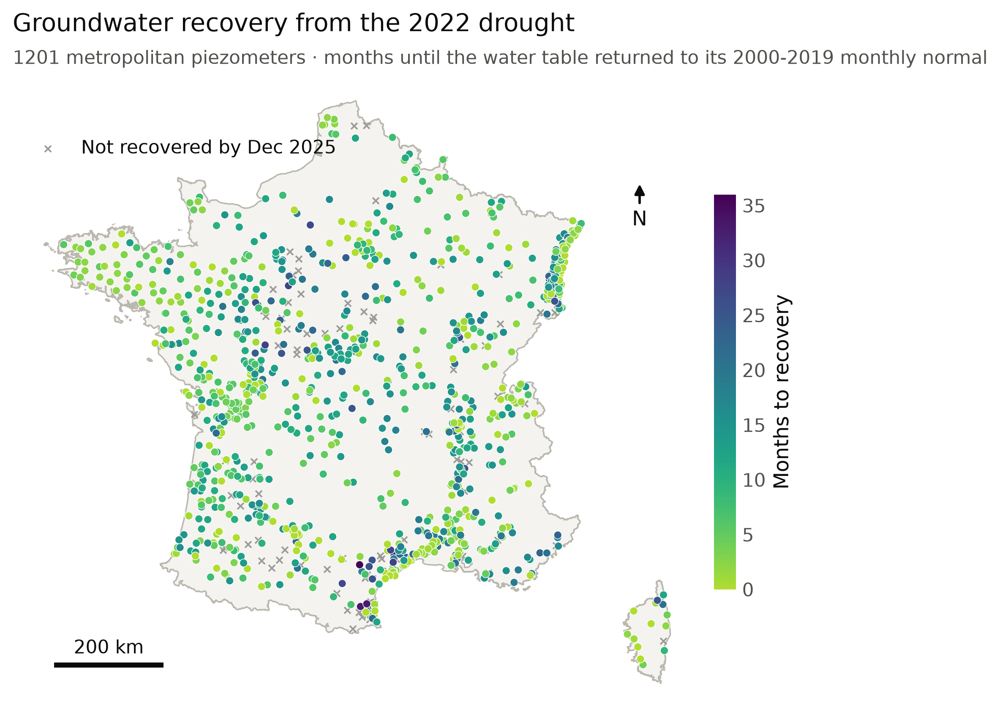
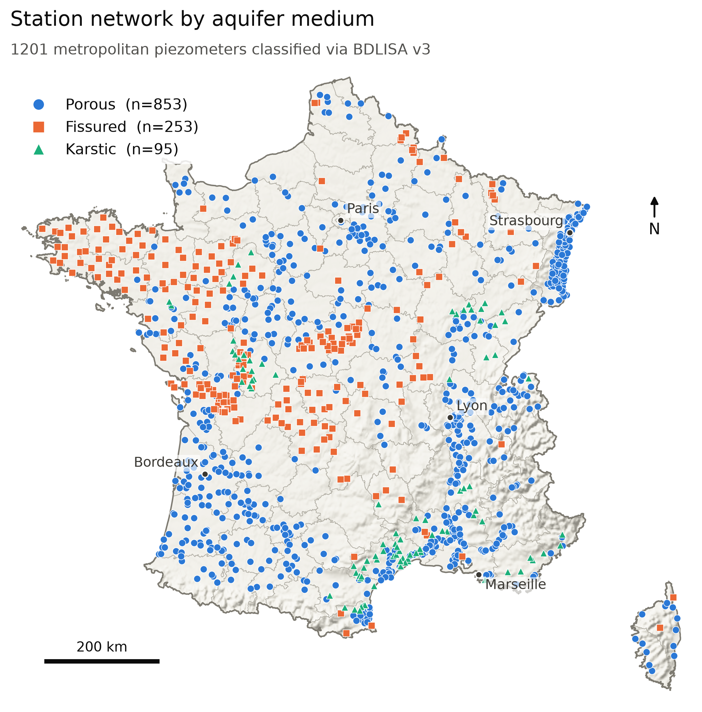
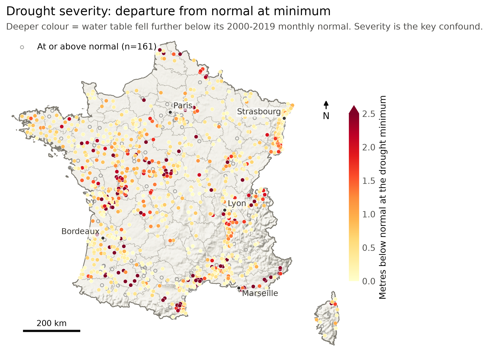
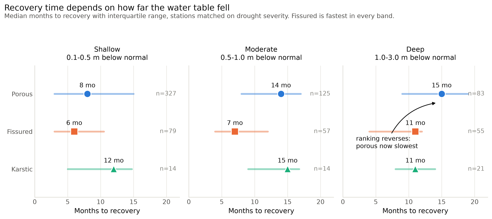
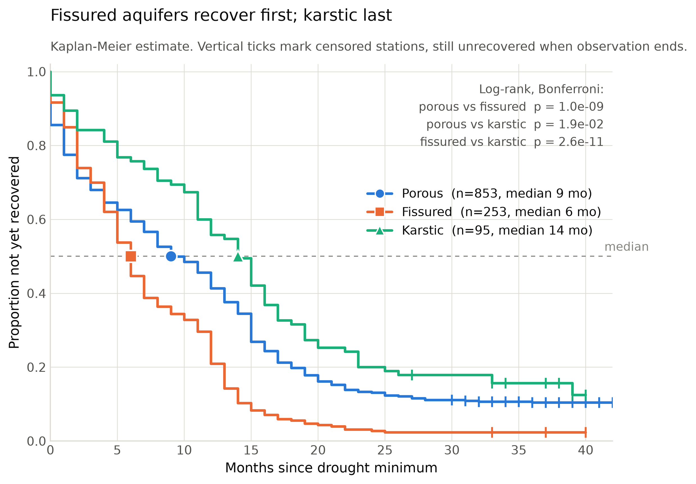
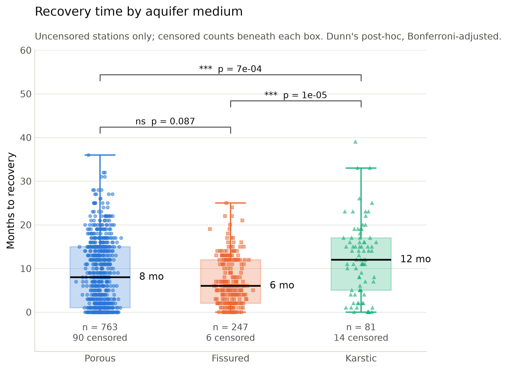
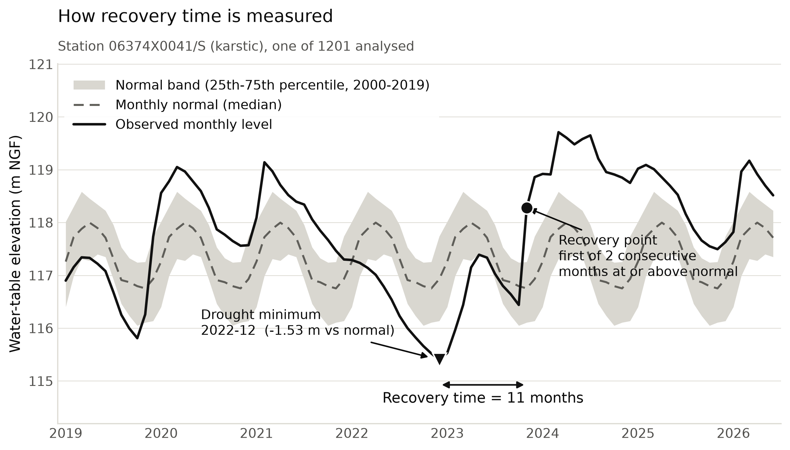
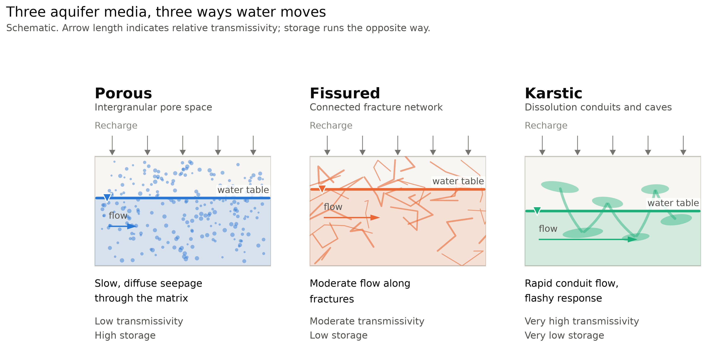

# Aquifer Memory

**Groundwater Recovery from the 2022 European Drought across French Aquifer Types**

Nelson Christopher · 2026

[**Download the A1 poster (PDF, 10.6 MB)**](poster/poster.pdf) · [preview PNG](poster/poster_preview.png)

---

## Abstract

The 2022 European drought drove groundwater levels to historic lows across France.
How quickly an aquifer recovers depends on its hydraulic properties — transmissivity,
storage coefficient and recharge mechanism — but empirical comparison of recovery
rates across aquifer types at national scale is limited. This study analyses 1,201
piezometers from the French national monitoring network, classified by aquifer medium
(porous, fissured, karstic) using the BDLISA v3 reference system, and measures the time
from each station's drought minimum until its water table returned to its 2000–2019
monthly normal. Pooled median recovery was 6 months for fissured aquifers, 8 for porous
and 12 for karstic, with all pairwise log-rank comparisons significant (*p* < 0.02).
Because karst water tables vary far more than porous ones, severity was standardised by
each station's own normal-band IQR before stratified comparison; fissured aquifers
remained fastest in every severity band (Kruskal–Wallis *p* < 0.05), and the apparent
reversal seen when matching on absolute metres did not survive standardisation. 110
stations (9%) had still not recovered by December 2025, disproportionately karstic and
deep-drawdown.

## Figures

| | | |
|:--:|:--:|:--:|
| <br>**Fig 1.** Recovery time | <br>**Fig 7.** Station network by medium | <br>**Fig 8.** Drought severity |
| <br>**Fig 2.** Severity-matched recovery | <br>**Fig 3.** Kaplan–Meier curves | <br>**Fig 4.** Pooled comparison |
| <br>**Fig 5.** Method definitions | <br>**Fig 6.** Aquifer media schematic | |

## Data sources

| Source | Used for | Licence |
|---|---|---|
| [Hub'Eau Piézométrie API](https://hubeau.eaufrance.fr/page/api-piezometrie) | Station metadata and piezometric time series | Licence Ouverte 2.0 (Etalab) |
| [BDLISA v3](https://bdlisa.eaufrance.fr/) via [Sandre](https://services.sandre.eaufrance.fr/) | Aquifer entity reference and `MilieuEH` medium classification | CC BY-NC-SA 2.0 FR |
| [Sandre nomenclature 353](https://api.sandre.eaufrance.fr/referentiels/v1/nsa/353.json) | Medium code definitions | CC BY-NC-SA 2.0 FR |
| [Natural Earth](https://www.naturalearthdata.com/) | 1:10m shaded relief basemap | Public domain |
| [france-geojson](https://github.com/gregoiredavid/france-geojson) | Metropolitan and département boundaries | Licence Ouverte |

The BDLISA licence is **non-commercial** (CC BY-NC-SA); derived products inherit that
restriction. Verified against the official *BDLISA version 3 — Descriptif de livraison*
(BRGM & Sandre, 08/09/2022), which states `Droits d'usage:
http://creativecommons.org/licenses/by-nc-sa/2.0/fr` and that the reference is
"diffusée gratuitement pour tout tiers sous condition d'une utilisation non
commerciale". Note this is an explicit exception to the Sandre site-wide notice, which
otherwise places content under Licence Etalab 2.0.

## Reproducing

Requires Python 3.11+ with `requests`, `pandas`, `numpy`, `scipy`, `geopandas`,
`rasterio`, `matplotlib`, `playwright` and `segno`.

```bash
pip install requests pandas numpy scipy geopandas rasterio matplotlib playwright segno
python -m playwright install chromium
```

Scripts run in numeric order. Those marked **Colab** must be run from a network that can
reach `hubeau.eaufrance.fr`; see [docs/pipeline-notes.md](docs/pipeline-notes.md) for why.

| Script | Does |
|---|---|
| `00_check_connectivity.py` | Reachability of Hub'Eau, BDLISA and Sandre, separating DNS / TCP / TLS failure |
| `01_explore_api.py` | Dumps the live Hub'Eau station and chronicle schema |
| `02_fetch_stations.py` | All stations with ≥120 measurements → `data/stations_raw.json` |
| `colab_fetch_stations.py` | **Colab** equivalent of `02`, producing `stations_output.zip` |
| `03_classify_bdlisa.py` | Joins stations to BDLISA medium, with a spatial fallback |
| `03a_bdlisa_check.py` | Verifies the join logic; writes the entity-level medium distribution |
| `03b_classify_from_colab.py` | Classification from the Colab output → `data/stations_classified.csv` |
| `04_drought_filter.py` | Drought-window coverage check and the station-count gate |
| `colab_02_fetch_chroniques.py` | **Colab** time-series fetch → `chroniques_output.zip` |
| `05_analyse_recovery.py` | Monthly levels, normals, drought minimum, recovery, Kruskal–Wallis + Dunn |
| `05a_sensitivity.py` | Robustness of the result to the recovery rule and to drought depth |
| `05b_survival.py` | Kaplan–Meier medians and pairwise log-rank |
| `05c_standardised.py` | Severity standardised by each station's normal-band IQR |
| `05d_update_stats.py` | Merges the standardised results into `data/stats_summary.json` |
| `06_figures.py` | Figures 2–5 |
| `07_cross_section.py` | Figure 6, the conceptual cross-section |
| `08_figure_checklist.py` | Confirms all eight figures exist at 300 dpi |
| `09_maps.py` | Figures 1, 7 and 8 on a shaded-relief basemap |
| `11_render_poster.py` | Renders `poster/poster.html` to A1 PDF and preview PNG |

Poster assets are built at print resolution with two environment hooks:

```bash
POSTER_SVG=1 python scripts/06_figures.py        # vector figures for the poster
POSTER_SVG=1 python scripts/07_cross_section.py
POSTER_DPI=600 python scripts/09_maps.py         # 600 dpi rasters for the maps
python scripts/11_render_poster.py
```

Large inputs are not committed — the chronicle archive (368 MB), the Natural Earth
relief raster (131 MB) and the BDLISA download are regenerated by the scripts above.

## Method summary

- **Normals**: median, p25 and p75 per calendar month over 2000–2019, requiring ≥10
  reference years in every month.
- **Drought minimum**: lowest monthly median between June 2022 and March 2023.
- **Recovery**: first of two consecutive months at or above the calendar-month normal.
  Stations not recovered by December 2025 are right-censored.
- **Primary test**: Kaplan–Meier with pairwise log-rank, Bonferroni-corrected, since
  censoring differs by group (karstic 15%, porous 11%, fissured 2%).
- **Confound control**: severity standardised by each station's normal-band IQR, because
  the median IQR runs 0.47 m (porous) to 0.87 m (karstic) and absolute metres are not
  comparable across media.

## Limitations

Pumping influence is not controlled; production wells may distort the recovery signal.
A single drought event may not generalise. The severe karstic stratum rests on 12
uncensored stations of 20. Aquifer medium correlates with climate, depth and thickness,
so association is not causation. BDLISA boundaries are generalised, and mixed-porosity
entities (19% of level-3 entities) are excluded by design.

## Licence

Code: MIT. Figures and poster: CC BY 4.0. Underlying BDLISA data remains CC BY-NC-SA
2.0 FR, which restricts commercial reuse of derived products.
